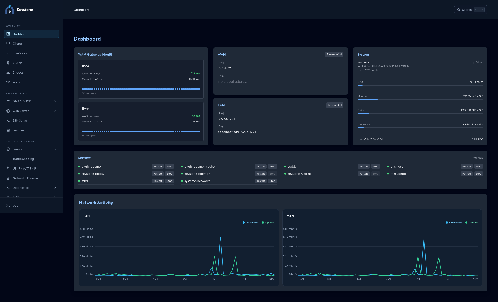
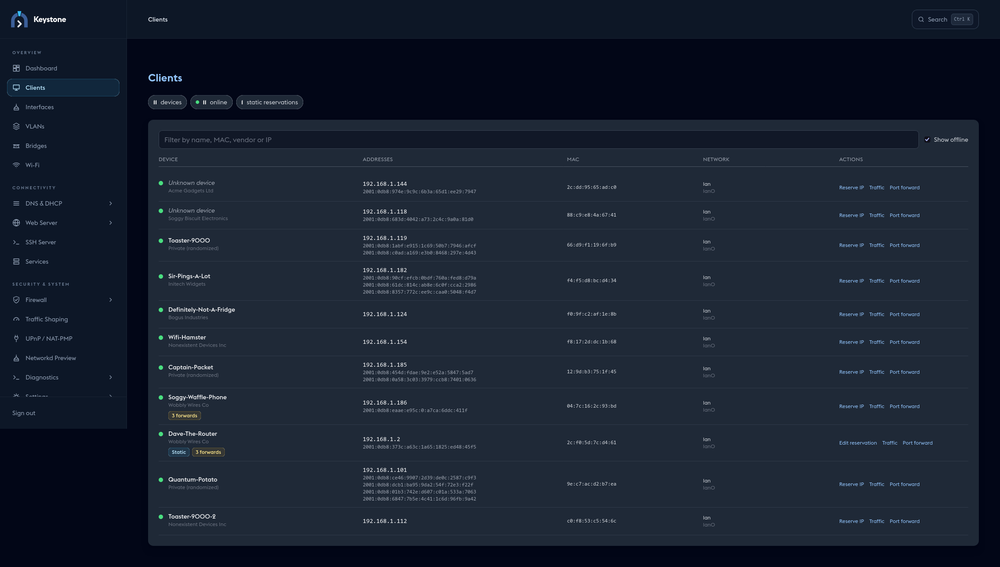

<div align="center">


# Keystone

**A web-managed router and firewall for Arch Linux, with a root daemon you never expose to the network.**

[](https://github.com/ripdog/keystone/actions/workflows/linux.yml)


</div>

Keystone turns a spare x86 box into a home or small-office router with a browser UI, a CLI and a safety net. It configures the standard Linux tools (systemd-networkd, nftables, dnsmasq, and friends) rather than replacing them, so what it generates is ordinary, inspectable system configuration.

> **Status: pre-1.0.** Keystone is under active development and used on real hardware, but network and firewall changes can disconnect a router. Try it on a spare machine or VM and keep console access while you configure it.

<p align="center">
  
</p>

<details>
<summary>More screenshots</summary>

<p align="center">
  
</p>

</details>

## Why Keystone

- **Safe to change remotely.** Edits are staged, previewed and applied together. Network and firewall applies come with a 60-second rollback timer, so a change that cuts you off reverts itself. Every apply is snapshotted and can be diffed, restored, exported and imported.
- **Privilege-separated by design.** The web server runs unprivileged and talks to a root daemon over a permission-restricted Unix socket. There is no daemon port, no default password, and the UI never listens on the WAN.
- **Opinionated setup, full control after.** A wizard builds a working dual-stack router (WAN DHCP/PD, LAN, NAT, firewall zones) in a minute; every part is then editable.
- **Plain Linux underneath.** No private network stack: stop Keystone and your router keeps running on networkd, nftables and dnsmasq.

## Features

| | |
|---|---|
| **Networking** | Physical interfaces, VLANs and bridges (convert a LAN port to a bridge in one step); static addressing, DHCPv4/v6 and IPv6 prefix delegation; Wi-Fi access point (hostapd); mDNS (`<host>.local`); live networkd preview |
| **Firewall** | Zone-based nftables: zones, zone forwards, input and forward rules, address/port groups, DNAT port forwards (individually switchable), NAT with hairpin support, DNS redirect enforcement, UPnP / NAT-PMP |
| **Firewall tooling** | Rule-set preview, packet tester, live log and connection tracking viewer |
| **DNS & DHCP** | dnsmasq: DHCP ranges, static and active leases, DHCP options, host/CNAME records, address overrides. Optional [Blocky](https://github.com/0xERR0R/blocky) for ad-blocking and encrypted upstreams, with a query log |
| **Traffic shaping** | SQM with CAKE to fight bufferbloat on the WAN |
| **HTTPS & remote access** | Caddy reverse proxy (including DNS-challenge certificates) and OpenSSH server settings |
| **Visibility** | Dashboard with traffic graphs, per-client view with vendor lookup, service status and logs, ping/traceroute/DNS/TCP tools, packet capture |
| **Operations** | Pending-changes tracking per component, configuration history, setup wizard, `keystonectl` with shell completions and a login banner, Arch package and USB image builder |

## Quick start

```bash
git clone https://github.com/ripdog/keystone.git && cd keystone
makepkg -si                                   # builds and installs keystone-router

sudo keystonectl bootstrap-admin              # create the first administrator, locally
sudo systemctl enable --now keystone-daemon keystone-web-ui
```

Then browse to `http://<router-LAN-address>:8080` (or `http://127.0.0.1:8080` on the router) and follow the setup wizard, or run `sudo keystonectl setup` for the terminal version. Review and apply the staged configuration, then **confirm within 60 seconds**; if you can't, Keystone rolls back on its own.

Full instructions, optional packages (Blocky, miniupnpd, Caddy, hostapd, ...), USB image creation and file locations are in the **[installation guide](docs/installation.md)**.

## How it fits together

```text
Browser ──HTTP(S)──> keystone-web-ui   (unprivileged, :8080 on loopback + LAN only)
                           │
                Unix socket (group keystone, 0660)  ◄── keystonectl
                           │
                    keystone-daemon     (root, SQLite)
                           │
 systemd-networkd · nftables · dnsmasq · Blocky · miniupnpd · hostapd · Caddy · avahi · tc
```

A Rust workspace of four crates: `core` (shared models), `daemon` (root backend), `web-ui` (Axum proxy + Leptos/WASM frontend) and `ctl` (`keystonectl`). See [architecture](docs/architecture.md) for the security model, configuration lifecycle and firewall design.

## Documentation

| Guide | Contents |
|---|---|
| [Installation & first run](docs/installation.md) | Requirements, building the package, USB image, setup wizard, CLI basics, file locations |
| [Architecture](docs/architecture.md) | Components, security model, apply/rollback lifecycle, firewall design |
| [Development](docs/development.md) | Toolchain, `just` commands, running locally, tests, packaging |
| [Vagrant testing](docs/vagrant.md) | Two-VM lab and end-to-end integration tests |
| [Changelog](CHANGELOG.md) | What changed in each release |
| [AGENTS.md](AGENTS.md) | Repository layout and rules for contributors and coding agents |

## Contributing

Issues and pull requests are welcome. Run `just ci` (formatting, Clippy and tests) before sending a change, add focused tests for new behaviour, and read the project rules in [AGENTS.md](AGENTS.md), particularly the ones on privilege separation and input validation.

## License

Keystone is licensed under the **GNU General Public License v3.0 only** (`GPL-3.0-only`). See [LICENSE](LICENSE).
